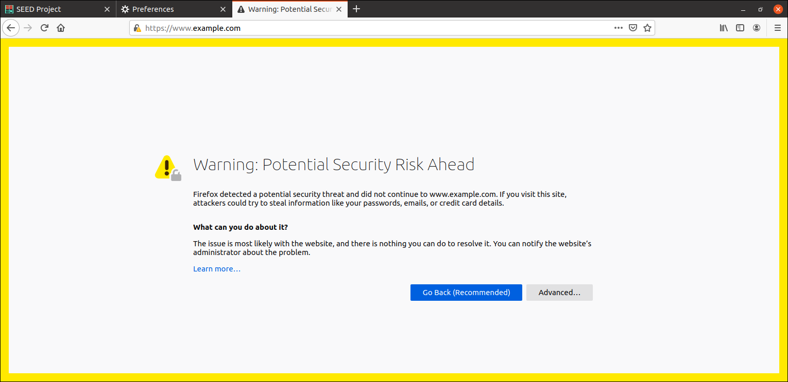
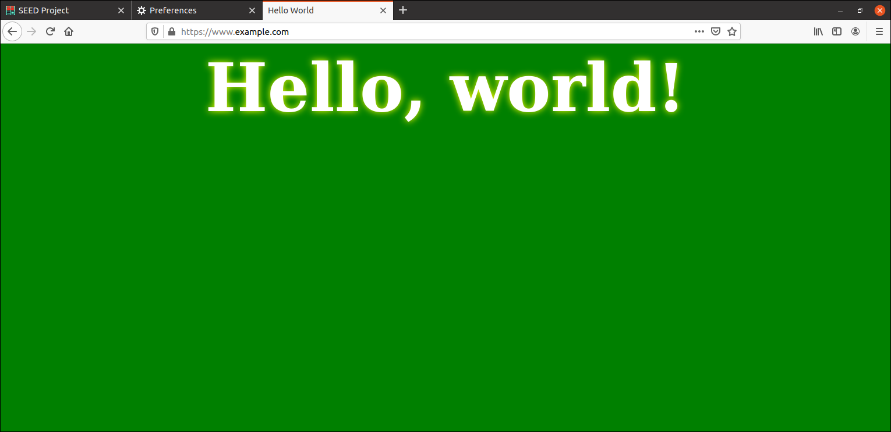

# Public Key Infrastructures
## Root CA certificate
O objetivo desta tarefa é criar e analizar um certificado CA raíz. Assim criamos 2 ficheiros: **index.txt** e **serial**, contendo o segundo o valor 42.
Após isso copiamos o ficheiro de configuração de geração de certificados padrão **/usr/lib/ssl/openssl.cnf** e permitimos a criação de multiplos certificados com o mesmo sujeito.
Finalmente geramos o certificado com o comando da imagem 1 e ganhamos acesso aos ficheiros .

**Imagem 1:** Criação de um certificado raíz


Após gerar o certificado, utilizamos o seguinte comando para analizar o seu conteúdo.

```bash
openssl x509 -in ca.crt -text -noout
```

```
Certificate:
    Data:
        Version: 3 (0x2)
        Serial Number:
            2f:2c:8e:28:cc:80:2f:0a:d0:d3:fb:89:ab:0d:69:9a:2c:6d:32:b9
        Signature Algorithm: sha256WithRSAEncryption
        Issuer: CN = www.modelCA.com, O = Model CA LTD., C = US
        Validity
            Not Before: Dec 10 09:36:45 2025 GMT
            Not After : Dec  8 09:36:45 2035 GMT
        Subject: CN = www.modelCA.com, O = Model CA LTD., C = US
        Subject Public Key Info:
            Public Key Algorithm: rsaEncryption
                RSA Public-Key: (4096 bit)
                Modulus:
                    00:a3:6d:df:d0:4d:db:e6:bb:14:96:9f:60:98:aa:
                    4d:97:35:05:4f:fb:29:38:b0:c2:c3:38:a6:6e:a1:
                    d0:5c:f1:fb:b6:f4:fd:1d:4e:ca:d8:83:e6:b9:a0:
                    d9:fd:7a:66:93:a3:ba:ef:0f:d2:8d:5e:dc:6f:3e:
                    d4:61:dc:e8:a9:77:25:fd:9d:95:1b:26:a5:c2:f1:
                    a7:68:ba:74:0a:da:0d:8c:be:09:86:27:09:bd:be:
                    3b:7a:41:72:8a:43:ad:5c:3b:21:16:42:68:46:f7:
                    c3:0b:5d:9f:f0:85:0e:98:76:6c:c8:48:6b:05:57:
                    90:a1:72:23:33:c2:8d:b2:1b:2d:94:82:f1:2e:4c:
                    1c:84:f6:44:15:7f:41:96:ea:41:71:66:70:a4:a7:
                    6c:3f:6d:e4:54:32:0e:48:82:21:ae:88:0b:b5:4e:
                    b0:03:e2:d2:2f:29:7b:4d:45:dd:c1:5d:0b:5b:28:
                    1f:3b:9e:aa:c1:a9:17:7d:a5:11:3c:d0:47:f8:a2:
                    8c:82:90:ca:ba:ad:52:23:89:52:58:b9:fc:54:33:
                    dd:ea:78:77:c6:3d:d4:4a:a7:4b:8f:3d:72:6f:9c:
                    6c:6d:ea:44:69:07:ed:02:7d:fc:d4:57:7b:91:db:
                    43:93:37:1f:1a:d5:3e:a3:a6:db:77:89:73:92:d3:
                    9f:b8:e3:8d:fd:7a:50:f9:3c:61:79:b1:b7:08:08:
                    c5:5a:b0:15:5e:e6:d8:c7:a2:11:eb:39:41:ec:c7:
                    d5:86:77:a9:a1:d0:e1:b2:c5:b3:70:06:4d:19:83:
                    35:67:0a:65:f2:b8:8a:d2:81:f2:d4:26:1a:36:38:
                    7c:ae:2b:1a:5a:98:a8:19:3d:62:5d:e0:02:3f:50:
                    0e:a7:de:13:9f:a5:09:a7:c3:af:60:07:b9:44:46:
                    46:dd:79:cc:94:33:fa:41:70:53:4b:4b:29:24:0d:
                    6e:79:78:de:17:45:56:e8:1d:63:60:19:1f:10:dc:
                    3a:55:ed:f5:ac:b3:29:89:42:94:55:d4:c4:74:3b:
                    21:44:c1:d8:44:c5:6d:fb:c1:c3:78:5e:78:f3:45:
                    c9:0a:33:d0:9d:5a:95:7d:fa:c7:a6:a7:4d:1b:f5:
                    06:5d:30:26:b2:2b:bb:9d:5a:34:1b:1b:9f:97:03:
                    40:7c:92:01:a0:ee:dd:e7:5d:7d:8b:56:ec:18:0f:
                    e7:79:36:88:23:d8:83:66:34:e5:b7:e7:f0:58:5c:
                    7a:78:4b:1b:5a:8e:1a:a5:eb:9a:ff:5f:88:98:8f:
                    6e:ab:f3:30:8b:56:3c:d3:de:00:d5:bc:2e:c5:3f:
                    4d:64:49:14:b3:f9:53:cb:63:c8:0e:e1:44:0d:f6:
                    0d:47:ab
                Exponent: 65537 (0x10001)
        X509v3 extensions:
            X509v3 Subject Key Identifier: 
                54:6F:3A:27:B9:8D:CC:E6:FC:7B:61:8F:27:D2:0D:DC:AA:28:CF:87
            X509v3 Authority Key Identifier: 
                keyid:54:6F:3A:27:B9:8D:CC:E6:FC:7B:61:8F:27:D2:0D:DC:AA:28:CF:87

            X509v3 Basic Constraints: critical
                CA:TRUE
    Signature Algorithm: sha256WithRSAEncryption
         6d:a8:ad:94:d9:ef:e5:8a:87:8b:e8:d4:af:1f:2d:77:a0:c8:
         14:7e:ec:f7:cf:66:b5:60:54:c9:2e:a8:97:f8:fe:79:47:61:
         bd:47:64:25:94:46:86:cf:84:1f:bf:c7:d4:b1:e0:5d:8a:c2:
         be:0e:99:69:59:a8:10:f4:75:b7:cc:07:6c:0b:2e:e3:32:6c:
         7a:5d:07:ee:3f:53:e6:ba:be:79:9e:6b:2c:38:f3:a8:4b:56:
         88:0e:b9:68:24:1b:b1:85:3e:64:77:32:c1:8a:d6:b7:1f:60:
         25:34:91:93:ef:e0:ed:e1:26:2e:59:98:95:ae:ae:2b:13:2c:
         0d:17:34:0f:bc:3d:ba:a4:f2:02:70:ad:db:36:53:4e:2b:4d:
         51:20:2d:17:99:9c:ed:f2:a3:da:29:7e:dc:c2:af:db:8a:31:
         5b:24:da:e4:bf:86:c7:ad:ed:13:68:0f:2d:6c:f5:a3:74:c0:
         89:76:74:3d:16:be:44:33:4b:41:e4:df:b6:55:a7:84:21:45:
         c5:16:02:37:73:b7:e0:b1:4f:cb:8a:75:db:08:7e:d3:c3:b7:
         39:b3:e8:34:20:b9:d9:73:2f:39:10:d1:e6:ff:26:c8:50:3e:
         eb:db:3a:9c:d3:35:44:e7:64:2e:c0:f1:49:fa:f3:00:ed:c0:
         09:78:e8:e5:5e:d5:c1:50:86:5c:21:a6:33:62:eb:22:f7:67:
         4d:24:aa:05:6f:ca:68:0a:e6:3f:31:39:35:04:31:a8:09:1d:
         5e:6b:33:3e:ac:34:e8:84:e3:0a:87:21:ac:85:be:f5:49:48:
         dc:ca:08:6d:27:24:d7:6f:4a:a8:b3:00:fa:8e:8b:f3:f8:f5:
         7b:bf:9c:9d:43:c6:2c:96:d9:12:66:43:e1:9e:e2:e8:14:99:
         0d:c6:03:f8:81:1b:c6:69:cf:10:7c:00:ce:c1:d6:66:d5:2f:
         04:e2:fa:24:ab:de:8c:f7:99:68:a7:a5:74:79:89:3a:bb:5f:
         45:de:f1:7a:65:98:8b:bf:64:de:17:5a:07:db:11:6c:ce:f6:
         04:3e:4a:8d:12:09:65:3a:75:ba:60:d1:62:eb:85:ca:0a:a1:
         83:b4:5b:81:43:1b:5b:97:a0:b1:93:1b:92:5f:f3:6e:f8:f2:
         fb:d2:93:62:5d:56:be:ba:cb:01:cf:ac:bf:0b:3e:c0:97:9b:
         60:e3:ff:ed:9e:08:c5:83:aa:cb:24:f3:89:c7:2b:cd:7b:39:
         12:48:41:cc:ab:45:ca:8a:fc:33:28:66:69:0f:65:8f:32:5b:
         45:f2:29:0c:1d:17:b5:51:45:ac:9b:45:5b:7b:f3:63:de:7b:
         4b:93:c9:99:cb:ba:9c:9e
```

A partir deste output podemos concluir que o certificado é uma **Certificate Autority** devido à extensão X509v3 Basic Constraints que está marcada como crítica:
```
    X509v3 Basic Constraints: critical
        CA:TRUE
```

A partir do certificado também comcluímos que é autoassinado devido a dois aspetos: 
- O **Issuer** é igual ao **Subject**;
- A **Subject Key Identifier** também é igual à **Autority Key Identifier**.

Estes dois fatores confirmam que se trata de um certificado raíz.

o certificado temos acesso aos parâmetros públicos do algoritmo RSA:

- Modulus (n), apresentado no campo Modulus;

- Public Exponent (e), apresentado como Exponent.

Estes valores são suficientes para realizar operações de encriptação e verificação de assinaturas RSA.

Para obter os restantes parâmetros do algoritmo RSA, necessários para desencriptação e assinatura, utilizámos o comando:
```bash
openssl rsa -in ca.key -text -noout
```

```text
Private-key parameters intentionally omitted from the public notes.
```
A partir deste output identificam-se os seguintes valores:

- Modulus (n): igual ao presente no certificado;
- Public Exponent (e): também disponível no certificado;
- Private Exponent (d): exponente privado;
- Prime1 (p): primo 1 utilizado para gerar o módulo;
- Prime2 (q): primo 2 utilizado para gerar o módulo.

## Server certificate request
Nesta tarefa vamos obter um certificado público assinado pela nossa Certificate Authority (CA) para o website **www.bank32.com**, que tem nomes alternativos. Para tal, é necessário gerar um Certificate Signing Request (CSR), que contém a chave pública do servidor e a informação de identidade da entidade requerente, gerado através do seguinte comando:

```bash
openssl req -newkey rsa:2048 -sha256 \
    -keyout server.key -out server.csr \
    -subj "/CN=www.bank32.com/O=Bank32 Inc./C=US" \
    -addext "subjectAltName=DNS:www.bank32.com,DNS:www.bank32A.com,DNS:www.bank32B.com" \
    -passout pass:<local-password>
```

## Certificate signing
O objetivo desta tarefa é assinar o CSR gerado na tarefa 2.

Como o certificado contém uma extensão, é necessário adicionar ao ficheiro de configuração myCA_openssl.cnf a linha "copy_extensions = copy" para permitir que a extensão apareça no certificado final.

Com o ambiente preparado e as configurações corretas, executámos o seguinte comando para assinar o certificado:

```bash
openssl ca -config myCA_openssl.cnf -policy policy_anything \
-md sha256 -days 3650 \
-in server.csr -out server.crt -batch \
-cert ca.crt -keyfile ca.key
```

Após gerar o certificado, verificámos o seu conteúdo com o comando:

```bash
openssl x509 -in server.crt -text -noout
```

No output seguinte verifica-se que o Issuer é a CA criada por nós e que os nomes alternativos estão presentes:

## HTTPS server configuration

O objetivo desta tarefa é configurar um servidor Apache com suporte a HTTPS, utilizando o certificado público assinado pela nossa Certificate Authority (CA) na tarefa anterior.

Em primeiro lugar, utilizámos os comandos do Docker para criar, correr e obter um terminal num contentor. No terminal copiámos o certificado (server.crt) e a chave (server.key) para a pasta /certs no contentor e um ficheiro de configuração foi criado em /etc/apache2/sites-available/bank32_apache_ssl.conf com o seguinte conteúdo:

```apache
<VirtualHost *:443>
    DocumentRoot /var/www/bank32
    ServerName www.bank32.com
    ServerAlias www.bank32A.com
    ServerAlias www.bank32B.com
    DirectoryIndex index.html
    SSLEngine On
    SSLCertificateFile /certs/server.crt
    SSLCertificateKeyFile /certs/server.key
</VirtualHost>
```

Com a configuração completa, iniciámos o servidor com os seguintes comandos:
```bash
a2enmod ssl
a2ensite bank32_apache_ssl
service apache2 start
```

Antes de acedermos ao servidor a partir do navegador, tivemos que adicionar o certificado raiz da CA criado na tarefa 1 (ca.crt) à lista de certificados do navegador, pois, como é uma entidade certificadora privada, o navegador não a aceita por defeito.

Finalmente conseguimos aceder ao website, como vemos na imagem:

**Imagem 2:** www.bank32.com


## MITM protection
O objetivo desta tarefa foi demonstrar como a Infraestrutura de Chaves Públicas (PKI) consegue impedir ataques do tipo Man‑In‑The‑Middle (MITM), mesmo quando o atacante consegue intercetar o tráfego e apresentar um website falso através de HTTPS.

Nesta tarefa reconfiguramos o servidor anterior para impersonar o website www.example.com utilizando os mesmos certificados do www.bank32.com com o seguinte ficheiro:

```apache
<VirtualHost *:443> 
    DocumentRoot /var/www/bank32
    ServerName www.example.com
    ServerAlias example.com
    DirectoryIndex index.html
    SSLEngine On
    SSLCertificateFile /certs/server.crt
    SSLCertificateKeyFile /certs/server.key
</VirtualHost>
```

De seguida, para simular um ataque de envenenamento de DNS, foi alterado o ficheiro /etc/hosts da máquina da vítima, mapeando o domínio www.example.com para o endereço IP do servidor malicioso.

Ao tentar aceder ao endereço https://www.example.com através do navegador Firefox, foi apresentada uma página de aviso com a mensagem “Warning: Potential Security Risk Ahead”, impedindo o acesso ao website como vemos na imagem 3. Isto aconteceu porque o servidor apresentou um certificado de um website distinto do qual estávamos a tentar aceder.

**Imagem 3:** Ataque MITM travado pela PKI.


## Compromised CA scenario

O objetivo desta tarefa foi demonstrar como um ataque Man‑In‑The‑Middle (MITM) pode ser bem‑sucedido quando uma Autoridade Certificadora (CA) raiz se encontra comprometida, permitindo ao atacante gerar certificados válidos para qualquer domínio. Neste cenário, a Infraestrutura de Chaves Públicas (PKI) deixa de conseguir proteger o utilizador, uma vez que a cadeia de confiança é quebrada na sua raiz.

Para realizar o ataque, foi reutilizado o ambiente da Tarefa 5. O servidor malicioso foi configurado para impersonar o website www.example.com
, mas desta vez foi gerado um novo certificado TLS para este domínio como vemos na configuração seguinte, assinado pela CA raiz comprometida (seguindo as instruções das tarefas 2 e 3). Como esta CA se encontra instalada e marcada como confiável no navegador da vítima, o certificado apresentado pelo servidor malicioso é considerado válido.

```apache
<VirtualHost *:443>
    DocumentRoot /var/www/bank32
    ServerName www.example.com
    ServerAlias example.com
    DirectoryIndex index.html
    SSLEngine On
    SSLCertificateFile /certs/example_com.crt
    SSLCertificateKeyFile /certs/example_com.key
</VirtualHost>
```

```bash
openssl req -newkey rsa:2048 -sha256 \
    -keyout example_com.key -out example_com.csr \
    -subj "/CN=www.example.com/O=Bank32 Inc./C=US" \
    -addext "subjectAltName=DNS:www.example.com,DNS:example.com" \
    -passout pass:<local-password>
```
```bash
openssl ca -config myCA_openssl.cnf -policy policy_anything \
    -md sha256 -days 3650 \
    -in example_com.csr -out example_com.crt -batch \
    -cert ca.crt -keyfile ca.key
```

Como a máquina da vítima já tem o domínio mapeado para o website comprometido, como na tarefa 5, acedemos o website malicioso e não o website pretendido. Como o certificado raíz está comprometido o browser não identifica o website como malacioso e o user encontra-se em perigo como vemos na imagem 4.

**Imagem 4:**  Ataque MITM
