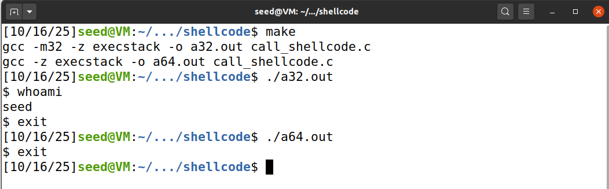

# Buffer-Overflow Attack Lab - Set-UID Version
## Questão 1
Na primeira parte do guião, desativamos o Address Space Randomization (de forma a conseguirmos 'adivinhar' os registros mais facilmente) e configuramos /bin/sh para zsh para facilitar permitir a execução da shell por processos com Set-UID.

Comandos usados:
>```bash
> $ sudo sysctl -w kernel.randomize_va_space=0
> $ sudo ln -sf /bin/zsh /bin/sh
>```

### Task 1

Na tarefa 1, fomos familiarizados com o shellcode.
Primeiramente executámos um programa que abre uma shell, devido ao uso do comando *execve()*.

Posteriormente, compilámos o programa call_shellcode.c e executámos os binaŕios a32.out e a64.out onde cada um deles abre uma shell.
Neste caso invocámos o shellcode a partir da stack.


### Task 2

Nesta tarefa, analisámos o comportamento de um programa vulnerável, stack.c, onde verificámos que ele tenta copiar um array com um máximo de 517 bytes, para um buffer com um tamanho máximo de 100 bytes. 
O *strcpy(buffer, str)* causa um buffer overflow, porque a função *strcpy()* apenas faz uma substituição do conteúdo no destino e não realiza nenhum tipo de verificação do tamanho do array, pelo que neste caso str > buffer.

Para compilar este programa vulnerável, desativamos o StackGuard e as proteções contra a execução de código por parte da stack. Também definimos como Set-UID.

### Task 3


## Questão 2
